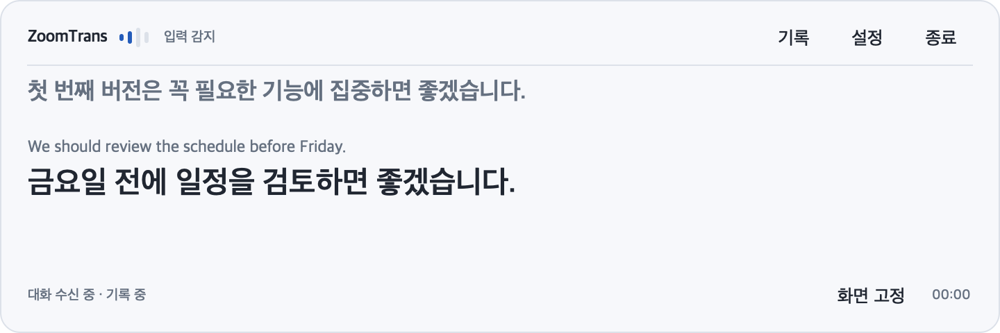
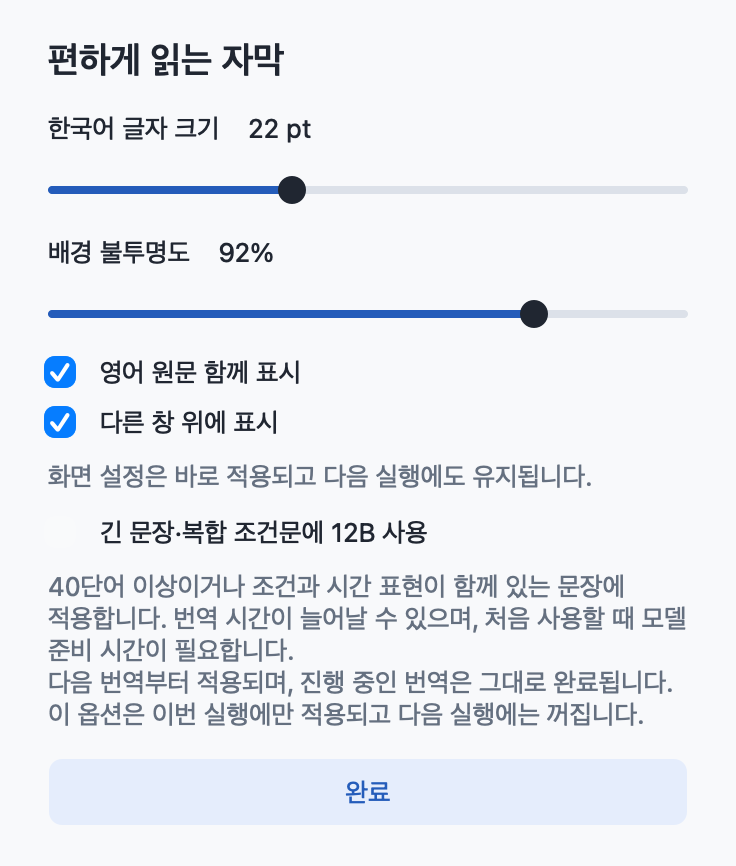

# ZoomTrans

macOS 회의 소리를 영어 원문과 한국어 자막으로 보여주는 로컬 번역 앱입니다. 회의록을 저장하고, 종료 후 선택하면 요약을 만듭니다. Zoom 외에도 Mac에서 재생되는 회의·강의 소리를 입력으로 사용할 수 있습니다.



**Preview · Apple Silicon · macOS 26 이상** — Intel Mac, Windows, Linux는 지원하지 않습니다. Python을 포함한 다운로드 앱을 제공하며, BlackHole·Ollama·AI 모델은 별도로 준비합니다. Zoom과 제휴하거나 Zoom에서 제공하는 앱이 아닙니다.

## 다운로드와 설치

[GitHub Releases에서 다운로드](https://github.com/Taeksu0710/zoomtrans/releases)하고 ZIP을 푼 뒤 `zoomtrans.app`을 응용 프로그램 폴더로 옮기세요. Python 설치는 필요하지 않습니다.

1. [설치 안내](docs/installation.md)에 따라 BlackHole 16ch와 Ollama를 설치합니다.
2. Ollama를 실행하고 터미널에서 `ollama pull gemma4:e4b`로 기본 번역 모델을 받습니다.
3. ZoomTrans를 실행합니다. Whisper 모델이 없으면 시작 준비 창에서 **Whisper 모델 다운로드**를 선택합니다.
4. 준비가 완료되면 회의 소리를 스피커로 들을지, 무음으로 자막만 볼지 선택합니다.

첫 설치와 모델 다운로드에는 인터넷과 충분한 디스크 공간이 필요합니다. 모델을 준비한 뒤 음성인식·번역·요약은 로컬에서 처리합니다. Preview 앱에는 Developer ID 서명과 공증이 없습니다. macOS가 실행을 막는 경우 [첫 실행 방법](docs/installation.md#macos-첫-실행)을 확인하세요.

## 주요 기능

- 영어 음성인식과 한국어 번역, 직전 대화 문맥 참고
- 긴 발화의 문장 연결과 순서대로 처리하는 번역 큐
- 현재 자막·최근 100개 발화 기록, 화면 고정과 최신 위치 이동
- 글자 크기·원문 표시·불투명도·다른 창 위 표시 설정
- 선택적 12B 번역: **설정 → 긴 문장·복합 조건문에 12B 사용**
- 회의록 저장과 선택적 회의 요약

12B 옵션은 기본 꺼짐이며 다음 일반 실행에도 꺼집니다. 켜면 40단어 이상 또는 조건·시간 표현을 함께 포함한 문장에 적용합니다. `ollama pull gemma4:12b`로 모델을 먼저 준비하세요. 처음 사용할 때 준비 시간이 추가되고 번역이 느려질 수 있습니다. 옵션 변경은 다음 작업부터 적용됩니다.



## 사용법

| 조작 | 동작 |
| --- | --- |
| 기록 / ⌘⇧H | 작은 자막과 발화 기록 전환 |
| 화면 고정 / ⌘⇧F | 화면만 고정; 인식·번역·저장은 계속 진행 |
| 최신으로 | 새 자막 위치로 이동 |
| 설정 / ⌘, | 화면 설정과 이번 실행의 12B 옵션 |
| 종료 / ⌘Q | 남은 작업과 회의록 저장 후 종료 |

단축키는 앱에 포커스가 있을 때 동작합니다. 제목 영역을 끌어 창을 이동하고 창 가장자리를 끌어 크기를 조절합니다. 화면 설정은 저장되며 시스템의 밝은·어두운 모드를 따릅니다.

다운로드 앱의 회의록은 `~/Library/Application Support/ZoomTrans/logs`에 저장합니다. 음성 녹음 파일은 저장하지 않습니다. 회의록·요약에는 실제 대화가 포함되므로 공유할 때 내용을 확인하세요. 로컬 진단 파일에는 원문·번역 내용을 넣지 않습니다.

## 소스에서 실행

Apple Silicon, macOS 26 이상, Python 3.11과 Xcode Command Line Tools가 필요합니다. BlackHole·Ollama·모델 준비는 다운로드 앱과 같습니다.

```sh
git clone https://github.com/Taeksu0710/zoomtrans.git
cd zoomtrans
python3.11 -m venv .venv
.venv/bin/python -m pip install -r requirements-lock.txt
.venv/bin/python main.py
```

```sh
.venv/bin/python main.py --help
.venv/bin/python main.py --silent
.venv/bin/python main.py --whisper-model small
.venv/bin/python main.py --complex-model gemma4:12b
.venv/bin/python main.py --device "BlackHole 16ch"
```

소스 실행의 기본 저장 위치는 `logs/`이며 `--log-dir`로 변경할 수 있습니다. 기본 음성인식 모델은 `large-v3`, 기본 번역 모델은 `gemma4:e4b`입니다.

## 문제 해결과 개발

- 소리가 인식되지 않음·모델 설치·macOS 실행 제한: [설치 및 문제 해결](docs/installation.md)
- 테스트·독립 앱 빌드·릴리스: [개발 안내](docs/development.md)
- 문장 처리·지연·평가 방법: [번역 동작과 품질 검증](docs/translation.md)
- 변경 사항: [CHANGELOG](CHANGELOG.md)
- 버그 제보: [Issues](https://github.com/Taeksu0710/zoomtrans/issues) — 실제 회의 내용 대신 합성 예문을 사용하세요.

번역과 요약은 오류·누락이 있을 수 있습니다. 긴 문장, 느린 모델, 작업 대기열은 지연을 늘립니다. 모든 기기에서 동일한 정확도나 속도를 보장하지 않습니다.

## 라이선스

프로젝트 코드는 [MIT](LICENSE)입니다. 함께 배포되는 라이브러리와 별도 설치하는 모델·드라이버에는 각각의 라이선스가 적용됩니다. [외부 구성요소 고지](THIRD_PARTY_NOTICES.md)를 확인하세요.
